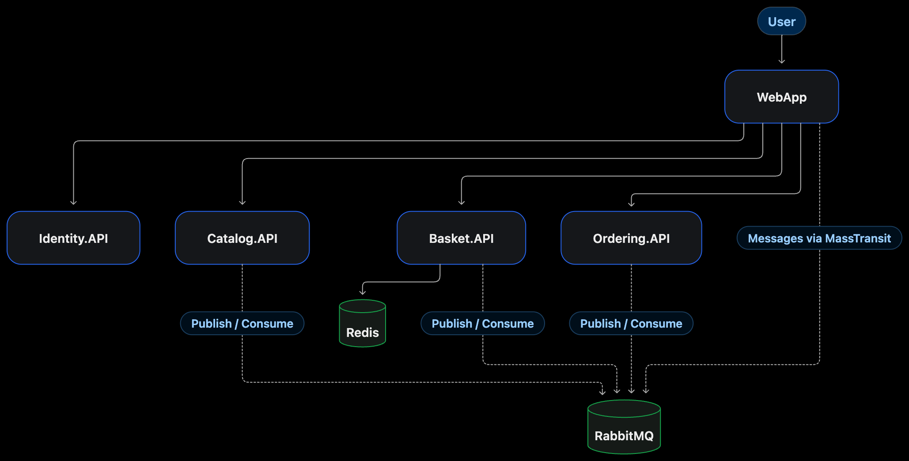

# eShop

A learning-oriented .NET microservices project inspired by [dotnet/eShop](https://github.com/dotnet/eShop), built to explore and experiment with **MassTransit, RabbitMQ, asynchronous messaging, and service-to-service communication**.

## Tech Stack

- **.NET / ASP.NET Core**
- **MassTransit & RabbitMQ** — asynchronous messaging
- **Redis** — basket storage
- **gRPC** — service communication
- **OpenID Connect** — authentication
- **Docker** — containerization

## Services

- **Identity.API** — Authentication
- **Catalog.API** — Product catalog
- **Basket.API** — Shopping basket
- **Ordering.API** — Order processing
- **WebApp** — Web interface

## Architecture

